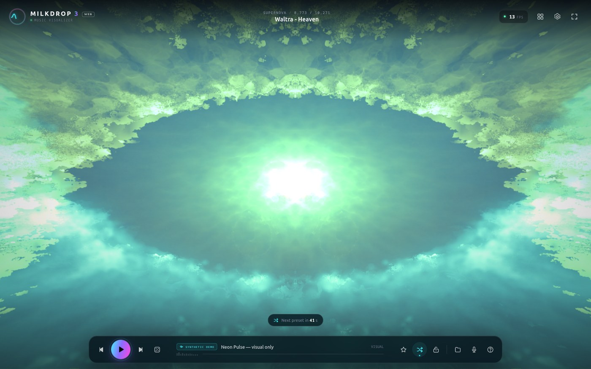
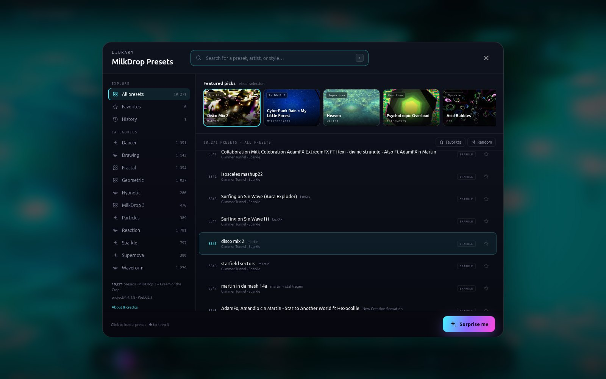
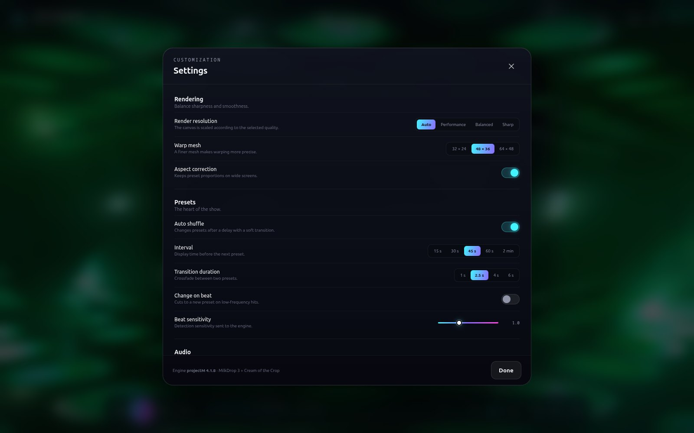
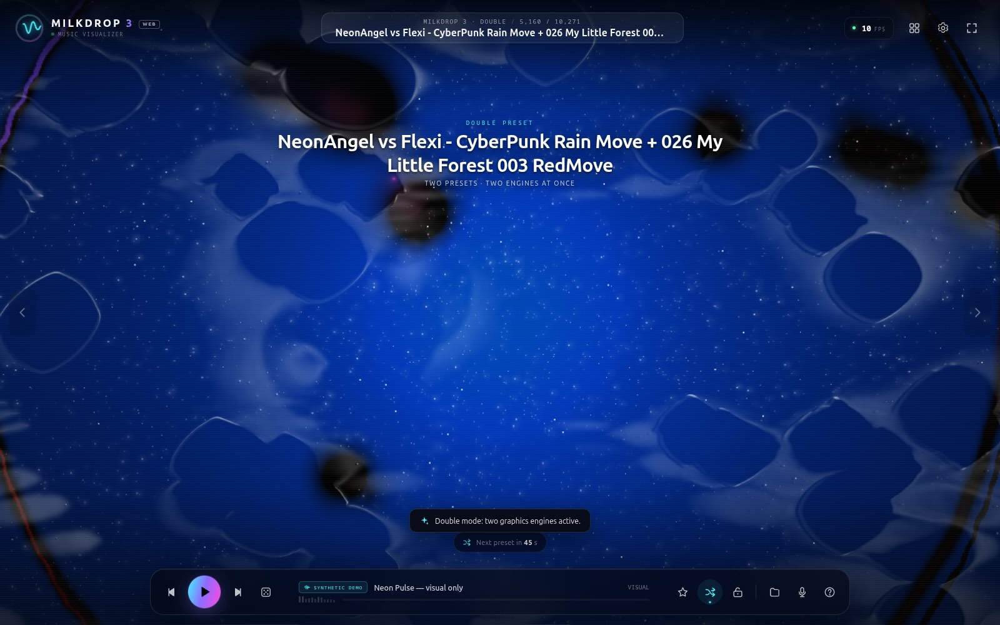
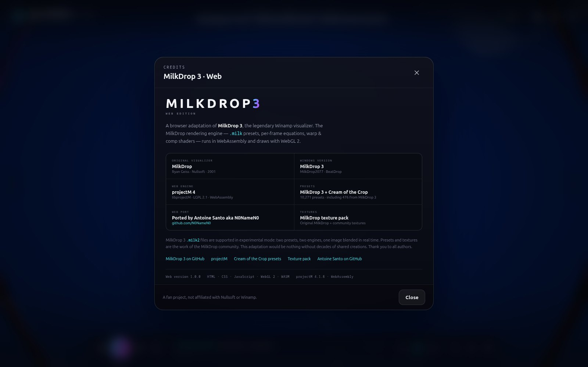
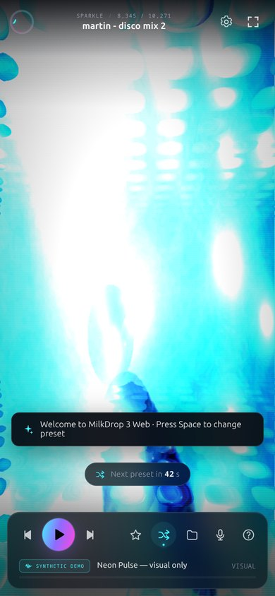
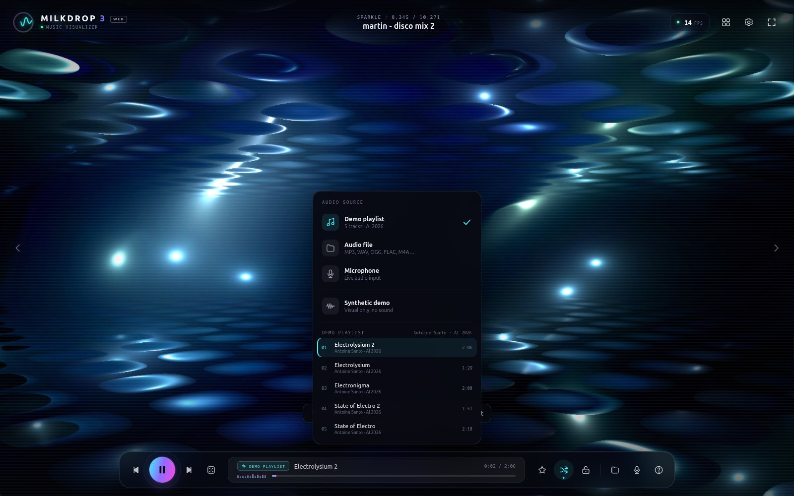

# MilkDrop 3 · Web

<p align="center">
  <a href="https://n0namen0.github.io/MILKDROP3/">
    
  </a>
</p>

<p>
  
  
  
  
  
  
</p>

A browser port of **MilkDrop 3**, the legendary Winamp audio visualizer.
Ported by **Antoine Santo aka [N0NameN0](https://github.com/N0NameN0)**.



## Live demo

**[Open MilkDrop 3 Web →](https://n0namen0.github.io/MILKDROP3/)**

The demo is deployed automatically from `main` with GitHub Actions to GitHub Pages.
The published site contains the app, the bundled WebAssembly engine, the preset
manifest and the 10,271 presets. Textures are already embedded in the WASM data file,
so the site stays lighter than the repository.

## Run it locally

No build step is required: the prebuilt WebAssembly engine and the preset library
are included. Serve the repository root with any static HTTP server (WebGL,
WebAssembly and microphone access need HTTP or localhost, not `file://`).

```bash
git clone https://github.com/N0NameN0/MILKDROP3.git
cd MILKDROP3
python3 -m http.server 8000
```

Then open <http://localhost:8000/>.

> On a remote machine, bind the server to the interface you want to expose:
> `python3 -m http.server 8000 --bind 0.0.0.0`. The app has no backend and no
> external runtime dependencies.

## What this project does

MilkDrop 3 is a Windows/Direct3D 9 application written in C++. This project brings
the experience to the browser with an **HTML / CSS / JavaScript** interface and a
**WebGL 2** rendering engine.

The MilkDrop rendering core — reading `.milk` presets, `per_frame`, `per_vertex`
and `per_pixel` equations, `warp` and `comp` shaders, textures, waveforms and
shapes — is provided by [projectM 4.1.8](https://github.com/projectM-visualizer/projectm),
the open-source cross-platform MilkDrop implementation, compiled to
**WebAssembly** with a C wrapper exposed to JavaScript. The interface, navigation,
audio player, library, settings and interactions are written specifically for this
project.

This approach lets the app read **10,271 presets**: 9,795 presets from the
*Cream of the Crop* collection and **476 presets from the MilkDrop 3 pack**
(including 146 double `.milk2` presets), with rendering fidelity far beyond an
approximate shader rewrite.


## Screenshots

| Visualizer | Preset library |
| --- | --- |
|  |  |
| **Settings** | **Double preset (.milk2)** |
|  |  |
| **Credits** | **Mobile layout** |
|  |  |

## Features

- **10,271 presets** across 12 categories, including 476 from MilkDrop 3
  (330 `.milk` + 146 `.milk2`).
- **Double `.milk2` presets**: two presets rendered simultaneously by two projectM
  engines and screen-blended, like MilkDrop 3's double visualizer.
- Real-time **WebGL 2** rendering with warp/comp shaders, feedback, blur, borders,
  motion vectors, waveforms and custom shapes.
- **Soft transitions** between presets and a configurable auto-shuffle.
- **Library** with full-text search (name, author, category), categories,
  persistent favorites, history, illustrated featured picks and a virtualized list.
- **Audio**: local files (MP3, WAV, OGG, FLAC, M4A…), microphone, a **5-track demo
  playlist** by Antoine Santo (*AI 2026*), or a silent synthetic visual demo on first load.
- **Audio-reactive visuals**: engine FFT/beat analysis, dock equalizer and an
  optional change-on-beat mode.
- **Fullscreen** with automatic UI hiding, **PNG capture**, drag & drop audio or
  presets, deep links (`?p=7868`).
- **Responsive** desktop / tablet / mobile interface, keyboard shortcuts and basic
  accessibility.
- A dark neon theme inspired by MilkDrop 3's visual identity.

## Demo playlist

The built-in audio source is a five-track playlist by **Antoine Santo**, album
*AI 2026*:

1. Electrolysium 2
2. Electrolysium
3. Electronigma
4. State of Electro 2
5. State of Electro

Tracks play in order, auto-advance at the end, and can be selected directly from
the audio-source menu. A silent procedural feed remains available for visual-only
demos.



## Controls

| Action | Shortcut |
| --- | --- |
| Next preset | `Space` or `→` |
| Previous preset | `←` |
| Random preset | `R` |
| Library | `B` or `/` |
| Auto shuffle | `S` |
| Lock preset | `L` |
| Fullscreen | `F` |
| Open an audio file | `O` |
| Microphone | `M` |
| Demo playlist | `D` |
| Play / pause | `P` |
| Capture PNG | `C` |
| Help | `H` |
| About | `A` |
| Close / exit fullscreen | `Esc` |

You can also drop an audio file, a `.milk` preset or a `.milk2` double preset onto
the page, use the mouse wheel over the dock to change the volume, or swipe
horizontally on mobile.

## Structure

```
index.html                  UI and modals
css/app.css                 Design system, HUD, responsive layout
js/main.js                  Orchestration, navigation, shortcuts, auto-shuffle
js/engine.js                JS ↔ WebAssembly bridge (projectM)
js/audio.js                 Web Audio, files, microphone, 44.1 kHz PCM
js/synth.js                 Procedural synthetic visual-only audio feed
js/milk2.js                 MilkDrop 3 double-preset (.milk2) reader
js/library.js               Manifest, search, favorites, history
js/browser.js               Virtualized library and featured picks
js/settings.js              Persistent preferences
assets/wasm/                Compiled projectM engine (milkdrop.js/.wasm/.data)
assets/demo/                 5-track demo playlist (AI 2026)
assets/previews/            Featured-pick thumbnails
presets/                    10,271 .milk / .milk2 presets
textures/                   MilkDrop texture pack (also embedded in the WASM)
manifest.json               Generated preset index
tools/                      WASM wrapper source and generation scripts
LICENSES/                   Licenses and credits
```

## WebAssembly engine

`assets/wasm/milkdrop.js` is generated from `tools/wasm/wrapper.cpp` and projectM
4.1.8. The wrapper exposes:

- `mdw_init(selector, width, height)` — creates the WebGL 2 context and projectM;
- `mdw_load_preset(text, smooth)` — loads a `.milk` preset;
- `mdw_add_pcm(ptr, count)` — feeds floating-point mono PCM;
- `mdw_render()` — draws a frame (`projectm_opengl_render_frame`);
- `mdw_resize`, `mdw_set_soft_cut`, `mdw_set_fps`, `mdw_set_mesh`,
  `mdw_set_aspect_correction`, `mdw_set_beat_sensitivity`, `mdw_destroy`.

The texture pack is embedded in the Emscripten filesystem with
`--preload-file textures@/textures`. Presets remain plain text files served over
HTTP and loaded on demand, so the library can change without rebuilding the engine.

The module is compiled with a **5 MB WebAssembly stack** (instead of the default
Emscripten stack) to handle the heaviest presets and shaders. If a load is rejected
by the engine, the app retries once without a transition; the current preset stays
visible if the failure persists.

The engine also supports two independent projectM modules for `.milk2` presets,
composited in the browser.

### Rebuilding the engine

Requirements: Docker, and optionally `git` inside the container.

```bash
./tools/build-wasm.sh
```

The script clones projectM v4.1.8, compiles the library and wrapper in the
`emscripten/emsdk:3.1.53` image, then copies `milkdrop.js`, `milkdrop.wasm` and
`milkdrop.data` into `assets/wasm/`.

Options: `PROJECTM_VERSION` (projectM tag, default `v4.1.8`), `EMSDK_IMAGE`.

### Regenerating the preset index

```bash
node tools/gen-manifest.mjs
```

The script scans `presets/`, extracts the author/title convention
`author - title`, computes categories and rewrites `manifest.json`.

## Known limitations

- `.milk2` double presets are rendered by **two projectM instances** and
  screen-blended. The blend is intentionally simpler than MilkDrop 3's patterns
  (`circle`, `plasma`, etc.); both presets are genuinely read and rendered
  simultaneously. Double mode is GPU-heavy: auto-shuffle excludes `.milk2` files.
  On modest hardware or software emulation, avoid chaining many doubles in a row.
- `.milk2` files are available in the **MilkDrop 3** category and can also be
  dragged and dropped onto the page.
- projectM does not cover 100% of the newest MilkDrop 3 extensions (`q1`–`q64`,
  16 simultaneous shapes/waves, some transition effects). The vast majority of
  classic presets work.
- A few experimental presets may stay black or render differently from MilkDrop 3
  on Windows. This is a projectM limitation, not an interface issue.
- The first load downloads the manifest (2.8 MB), the WASM (0.9 MB) and the embedded
  texture pack (3.7 MB). Subsequent loads are cached by the browser.
- WebGL 2 and a recent browser are required. Fullscreen and microphone access need
  a secure context (localhost or HTTPS).

## Credits

- **Web port** — Ported by Antoine Santo aka [N0NameN0](https://github.com/N0NameN0).

- **MilkDrop** — Ryan Geiss, Nullsoft (2001). The name and spirit of the project
  belong to him.
- **MilkDrop 3** — [MilkDrop2077](https://github.com/milkdrop2077/MilkDrop3),
  based on BeatDrop by Maxim Volskiy. BSD 3-Clause.
- **projectM 4** — [projectM Visualizer](https://github.com/projectM-visualizer/projectm),
  LGPL 2.1. This is the rendering engine of this web adaptation.
- **Cream of the Crop presets** — curated by Isosceles / Jason Fletcher,
  [projectM repository](https://github.com/projectM-visualizer/presets-cream-of-the-crop).
  Presets are the work of the MilkDrop community.
- **MilkDrop texture pack** —
  [presets-milkdrop-texture-pack](https://github.com/projectM-visualizer/presets-milkdrop-texture-pack).
- **Demo playlist** — Antoine Santo, *AI 2026* (5 tracks, included in `assets/demo/`).
- **Web interface and integration** — MilkDrop 3 Web, code under the MIT license.

See [LICENSES/](LICENSES/) for the full texts.

## Tests

Checks performed during development:

- engine, manifest and initial preset loading;
- dozens of presets rendered through headless captures, including the MilkDrop 3
  category;
- `.milk2` double preset loading, two-engine composition and blended PNG capture;
- demo playlist track selection, play/pause/resume and WAV file playback;
- search, categories, favorites, history, deep links;
- modals open/close, settings, fullscreen, PNG capture;
- microphone denial without breaking current playback;
- mobile layout at 390 × 844.

Diagnostic API exposed in the console:

```js
window.__md.ready
window.__md.getFps()
window.__md.loadPreset(7868)
window.__md.loadByPath('Waveform/Wire Circular/Geiss - Confetti (Jelly).milk')
window.__md.loadByPath('MilkDrop 3/000.milk2')
window.__md.openBrowser()
```

## License

The web interface and integration code are released under the **MIT license**
(see [`LICENSES/app-MIT.txt`](LICENSES/app-MIT.txt)). The projectM rendering engine
is distributed under **LGPL 2.1**; its wrapper source and build script are included
in [`tools/`](tools/) so the WebAssembly module can be rebuilt or replaced. Presets
and textures remain the work of their respective authors; see
[`LICENSES/`](LICENSES/) for details and credits.

MilkDrop was created by Ryan Geiss / Nullsoft. MilkDrop 3 is developed by
MilkDrop2077. This is an unofficial fan web port, not affiliated with Nullsoft,
Winamp, or the original authors.
